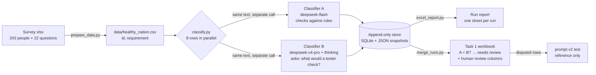

# LLM FR/NFR Requirements Classifier

**English** | [中文](README.zh-CN.md)

A Python pipeline that uses two independent DeepSeek models to classify crowd-sourced software requirements as **Functional (FR)** or **Non-Functional (NFR)**. Rows where the two models disagree are flagged for human review. All raw AI output is kept in an append-only store.

It was used to classify **5,324 real requirements** written by university students. The two classifiers agreed on **95.4%** of them, and the other **244** were flagged for human review.

> This project was developed with extensive AI assistance. AI was responsible for much of the initial code implementation, while I defined the requirements, directed the development, reviewed outputs, identified issues, and guided corrections. I also validated the system against its intended workflow.
>
> More detail: [AI Assistance](#ai-assistance) · [Development Process](docs/development-process.md)

---

## Contents

1. [Background](#background)
2. [How It Works](#how-it-works)
3. [Results](#results)
4. [Repository Layout](#repository-layout)
5. [Getting Started](#getting-started)
6. [Usage](#usage)
7. [Output Files](#output-files)
8. [Design Decisions](#design-decisions)
9. [Limitations](#limitations)
10. [Language Note](#language-note)
11. [AI Assistance](#ai-assistance)
12. [License](#license)

---

## Background

This was my part of a university **Systems Analysis & Design** group assignment on Crowd Requirements Engineering (CrowdRE). Students wrote requirements for a fictional government health app, the "Healthy Nation App". The group had to design an AI-assisted workflow to analyse them.

I was responsible for **Task 1: FR/NFR classification**. Teammates did the other tasks and the human review, so those are not in this repo.

The assignment had strict rules, and they shaped the design:

- AI output must be **saved before** any human judgement and **never overwritten**.
- Requirement **IDs must not change**.
- Run **times and results must not be made up**.
- Every AI result needs a **human decision**: Accepted, Modified or Rejected.

## How It Works



1. **Prepare.** `prepare_data.py` turns the wide survey sheet into one requirement per row. IDs look like `001-01` (respondent-question) and deliberately do **not** contain "FR" or "NFR", so they cannot hint at the answer. The sheet each answer came from is stored in a separate file that is never sent to the model.
2. **Classify.** Every requirement goes to **two classifiers in separate API calls**. Neither sees the other's answer.
   - **A** (`deepseek-flash`, temperature 0) compares the requirement with the FR/NFR definitions and five boundary rules.
   - **B** (`deepseek-v4-pro`, thinking mode) first states what a tester would check, then picks the label.
3. **Validate.** Each reply must be one JSON object with a valid label, the **same ID that was sent**, all required fields, and a reason of at most 30 words. A failed check is retried up to 2 times, then marked `INVALID`.
4. **Store.** Every result goes straight into SQLite. A JSON snapshot of the run is saved at least every 10 seconds and again on exit. Nothing is ever overwritten.
5. **Report.** Each run gets a new sheet in an Excel run report.
6. **Merge.** `merge_runs.py` combines several runs (for example, a first run plus a resume run) into one workbook. It flags A ≠ B rows and adds empty human-review columns with drop-down lists.

Prompt details and the v1 → v2 changes are in [docs/prompt-design.md](docs/prompt-design.md).

## Results

### v1: full dataset (official AI output)

| Metric | Value |
|---|---|
| Non-empty requirements | 5,324 (out of 5,346 cells) |
| Rows where both A and B returned a valid label | 5,324 (0 failures after resume) |
| **A and B agree** | **5,080 (95.4%)** |
| A and B disagree → flagged for human review | 244 |
| A: FR / NFR | 2,888 / 2,436 |
| B: FR / NFR | 3,040 / 2,284 |
| A matches the survey sheet* | 94.3% |
| B matches the survey sheet* | 92.3% |

\* "Survey sheet" is whether the student typed the answer on the FR sheet or the NFR sheet. It shows **the student's intent, not an expert answer key**, so these numbers are **not accuracy**.

### v2 prompt: the 244 disputed rows only

| | v1 A | v1 B | v2 A | v2 B |
|---|---|---|---|---|
| Matches survey sheet | 70.9% | 29.1% | 90.6% | 78.7% |

v2 A and v2 B agree on 80.7% of these rows. Because v2 was run only on the hardest rows, with no control group, it is used as a **reference for reviewers** and does not replace v1.

### Time and cost

| | Value |
|---|---|
| Wall-clock time, v1 (two runs because the API balance ran out) | 28 min 35 s + 42 min 53 s |
| Sum of per-call times, v1 | A ≈ 79 min, B ≈ 469 min (larger than wall-clock time because 8 rows run in parallel) |
| Average time per call | A ≈ 0.8 s, B ≈ 5 s |
| Cost, v1 + v2 | ≈ US$7–8 (an **estimate**; about 90% of it was `deepseek-v4-pro`) |

### Examples

[`examples/real_sample_results.csv`](examples/real_sample_results.csv) holds **40 anonymised rows** from the real run: 20 where A and B agreed (randomly sampled) and 20 where they disagreed (chosen to show typical cases such as encryption, error logging, accuracy, reliability and multi-requirement cells). Every row includes both models' labels and reasons, and the v2 labels for the disputed rows.

## Repository Layout

```
llm-fr-nfr-classifier/
├── classify.py            Main script: calls classifiers A and B, validates, stores, reports
├── prompts_v2.py          Revised v2 prompt (the v1 prompt lives in classify.py)
├── merge_runs.py          Merges several runs into the Task 1 workbook and the review subset
├── prepare_data.py        Survey xlsx (wide) → data/*.csv (one requirement per row)
├── excel_report.py        Appends one sheet per run to the Excel run report
├── tests/
│   └── test_classify.py   14 offline tests (no API calls, no real key)
├── examples/
│   ├── sample_requirements.csv    20 made-up requirements for a quick demo
│   └── real_sample_results.csv    40 anonymised rows from the real run
├── docs/
│   ├── development-process.md     Timeline, decisions, problems found and fixed
│   └── prompt-design.md           Prompt structure, v1 findings, v2 changes
├── requirements.txt
├── .env.example
└── LICENSE
```

These folders are created at run time and are git-ignored: `data/` (input), `results/` (raw AI output), `FINAL/` (merged workbook).

## Getting Started

**Requirements:** Python 3.10+ and a [DeepSeek API key](https://platform.deepseek.com/).

```bash
git clone https://github.com/07-teh/llm-fr-nfr-classifier.git
```

```bash
cd llm-fr-nfr-classifier && python -m venv .venv && source .venv/bin/activate
```

```bash
pip install -r requirements.txt
```

```bash
cp .env.example .env
```

Then open `.env` and put your own key after `DEEPSEEK_API_KEY=`. **Never commit `.env`.** It is already in `.gitignore`.

Run the offline tests. They make no API calls:

```bash
python -m unittest discover -s tests -v
```

## Usage

Data, result and snapshot paths (`--data`, `--skip-done`, `--export-run`, the run files given to `merge_runs.py`) are resolved relative to the project folder, so the scripts can be run from any directory. The one exception is the survey file given to `prepare_data.py`, which is resolved from your current directory.

### Quick demo (20 made-up requirements, costs a few cents)

```bash
python classify.py --data examples/sample_requirements.csv
```

This prints each row's A and B labels as they finish, then writes `results/answers/run_<time>.json` and a new sheet in `results/team_results.xlsx`.

### Real survey data

```bash
python prepare_data.py path/to/survey.xlsx
```

The survey file must have two sheets, `Functional Requirements` and `Non-Functional Requirements`. Each sheet starts with the columns `Id, Start time, Completion time, Email, Name`, followed by one column per question. The script creates `data/healthy_nation.csv` (sent to the model) and `data/healthy_nation_expected.csv` (never sent).

```bash
python classify.py
```

### Resume after an interruption

If a run stops part-way (balance ran out, network failure, Ctrl+C), rerun only the rows where A or B did not finish. Rows that already succeeded are not paid for again, and old results are left untouched:

```bash
python classify.py --skip-done results/answers/run_<first>.json
```

### Merge runs into the Task 1 workbook

```bash
python merge_runs.py results/answers/run_<first>.json results/answers/run_<resume>.json
```

This creates `FINAL/task1_results.xlsx` (a Task1 sheet and a Summary sheet) and `data/healthy_nation_review.csv` (the disputed rows). If the human-review columns already contain data, the script refuses to overwrite them unless you add `--force`. This step needs `data/healthy_nation_expected.csv`, so it works only on data produced by `prepare_data.py`.

### Test prompt v2 on the disputed rows

```bash
python classify.py --prompts v2 --data data/healthy_nation_review.csv
```

v2 results go to separate `*_v2.db` files. To add them to the workbook as reference columns:

```bash
python merge_runs.py results/answers/run_<first>.json results/answers/run_<resume>.json --v2 results/answers/run_<v2>.json
```

### Rebuild the Excel report from a snapshot (no API calls)

```bash
python classify.py --export-run results/answers/run_<time>.json
```

### Settings

Settings are constants at the top of `classify.py`: models, thinking mode, temperature, `WORKERS` (default 8), `MAX_RETRIES` (default 2), `SAVE_INTERVAL` (default 10 s) and file paths.

## Output Files

| File | Contents | Written |
|---|---|---|
| `results/db/a_results.db`, `b_results.db` | One row per call: `record_id`, `label`, `processed_at` | After every row |
| `results/answers/a_<time>.json`, `b_<time>.json` | Full model answers (reason, test focus, errors, raw output on failure) | At least every 10 s, and on exit |
| `results/answers/run_<time>.json` | Run snapshot: models, prompt version, **full prompt text**, status, every row's A and B results | At least every 10 s, and on exit |
| `results/team_results.xlsx` | One sheet per run, A and B side by side | On exit |
| `FINAL/task1_results.xlsx` | Merged result, A = B flag, AI-only decision, human-review columns, summary | By `merge_runs.py` |

Labels other than FR/NFR: `INVALID` (the reply failed validation after retries), `ERROR` (the API call failed), `SKIPPED` (the cell was empty), `NOT_RUN` (the row was never reached).

## Design Decisions

These choices are deliberate:

- **Two different classifiers instead of one.** Their disagreement is a cheap way to find hard rows for human review.
- **A and B never see each other's answer.** If one saw the other's label, the two votes would no longer be independent.
- **One API call per requirement, with no chat history.** One requirement cannot influence the next.
- **The ID is sent to the model, and the reply must echo it.** This catches mixed-up replies. IDs never contain the answer.
- **Append-only storage.** The assignment requires that raw AI output is never overwritten. Reruns add new rows and new sheets.
- **Resume checks both the ID and the requirement text.** If the text was edited, the old result is not reused.
- **The v1 output stays the official result.** v2 was written after seeing v1's mistakes, so using it to replace v1 would mean tuning the prompt on the same data it is scored on.
- **The AI-only decision defaults to B** (the stronger model with thinking mode). Every disagreement is still sent to a human.
- **A plain Excel layout** (no merged cells, colours or formulas), so teammates can sort and filter without breaking anything.

## Limitations

- **No real accuracy figure.** The expert answer key was not available. The survey sheet only shows the student's intent.
- **A and B differ in model, thinking mode and prompt at the same time**, so a disagreement cannot be blamed on any one of them.
- **v2 was tested only on the disputed rows**, with no control group.
- **Human review was done by teammates** and is not part of this repo.
- The original survey data is not published (see [Data and Privacy](#data-and-privacy)).
- `prepare_data.py` and `merge_runs.py` expect this survey's format. `classify.py` works on any `id,requirement` CSV or XLSX file.

### Data and Privacy

The full survey responses (5,346 cells) are **not included**. The survey was already anonymised (the email column held `anonymous` and the name column was empty). Even so, only 40 rows are published, with new IDs (`S01`–`S40`) and no respondent numbers or timestamps. The demo file `sample_requirements.csv` was written for this repo and contains no survey data.

## Language Note

This project was **developed in Chinese**: code comments, CLI messages, Excel headers, the README and the working notes. For this portfolio release, everything was **translated into English afterwards**. The prompts sent to the models were in English from the start and are unchanged.

| Changed for the release | Not changed |
|---|---|
| Comments, docstrings, CLI and error messages translated to English | Program logic, control flow, retry rules, CLI flags |
| Excel headers and run-status strings translated to English | The v1 and v2 prompt texts (byte-for-byte identical) |
| `sad_asg.py` → `classify.py`, `test_sad_asg.py` → `tests/test_classify.py` | JSON keys, database schema, output folder layout |
| New README, docs and examples; the git history starts fresh | The results reported above (they come from the original Chinese-version runs) |

The translation was done by OpenAI Codex CLI, then reviewed, and the 14 offline tests were run again afterwards.

## AI Assistance

> This project was developed with extensive AI assistance. AI was responsible for much of the initial code implementation, while I defined the requirements, directed the development, reviewed outputs, identified issues, and guided corrections. I also validated the system against its intended workflow.

Tools used:

| Tool | Role |
|---|---|
| Claude (claude.ai, Claude Code) | Explained concepts, drafted prompts on request, wrote most of the code, ran jobs, analysed results |
| OpenAI Codex CLI | Cross-model reviewer: checked diffs and the v2 prompt for bugs and counter-examples. It found two real bugs (see the development log). It also translated the code for this release. |
| DeepSeek API | The classifiers themselves (`deepseek-flash`, `deepseek-v4-pro`) |

What I did: designed the A/B workflow and the storage layout, made the main decisions along the way (finish the full run instead of a sample, audit the prompt, keep v1 official and test v2 only on disputed rows), studied the code line by line so I could explain it to my team, and checked the outputs against the assignment rules. The full timeline, including which problems were found by whom, is in **[docs/development-process.md](docs/development-process.md)**.

## License

[MIT](LICENSE)
