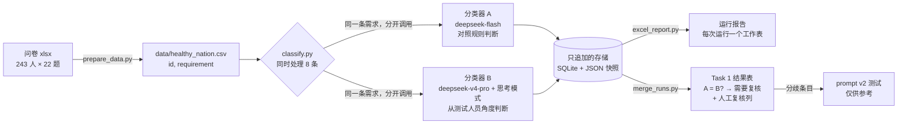

# LLM 需求分类器（FR / NFR）

[English](README.md) | **中文**

这是一个 Python 流程，用两个互相独立的 DeepSeek 模型，把众包收集到的软件需求分成**功能需求（FR）**和**非功能需求（NFR）**。两个模型意见不一致的条目会标出来，交给人工复核。所有 AI 原始输出都只追加保存，不会被覆盖。

这个流程实际分类了 **5,324 条**大学生写的真实需求：两个分类器在 **95.4%** 的条目上结论一致，其余 **244 条**标为需要人工复核。

> This project was developed with extensive AI assistance. AI was responsible for much of the initial code implementation, while I defined the requirements, directed the development, reviewed outputs, identified issues, and guided corrections. I also validated the system against its intended workflow.
>
> （中文大意：本项目在开发过程中大量借助 AI。AI 写了大部分初始代码；我负责定义需求、主导开发方向、审查输出、发现问题并指导修正，最后对照预期流程验证了整个系统。）
>
> 详见：[AI 协助说明](#ai-协助说明) · [开发过程（英文）](docs/development-process.md)

---

## 目录

1. [背景](#背景)
2. [运作方式](#运作方式)
3. [结果](#结果)
4. [仓库结构](#仓库结构)
5. [安装](#安装)
6. [使用方法](#使用方法)
7. [输出文件](#输出文件)
8. [刻意的设计](#刻意的设计)
9. [局限](#局限)
10. [语言说明](#语言说明)
11. [AI 协助说明](#ai-协助说明)
12. [授权](#授权)

---

## 背景

这个项目是大学 **Systems Analysis & Design（系统分析与设计）** 小组作业里我负责的部分，主题是众包需求工程（CrowdRE）。同学们为一个虚构的政府健康 App（"Healthy Nation App"）写需求，各组要设计一套 AI 辅助的分析流程来处理这些需求。

我负责的是 **Task 1：FR/NFR 分类**。其他任务和人工复核由组员负责，不在这个仓库里。

作业有几条硬性规定，直接影响了设计：

- AI 的输出必须在人工判断**之前保存**，并且**不能被覆盖**。
- 需求的**编号不能改**。
- 运行**时间和结果不能造假**。
- 每个 AI 结果都要有**人工判断**：Accepted（接受）、Modified（修改）或 Rejected（拒绝）。

## 运作方式



1. **准备数据**：`prepare_data.py` 把问卷宽表转成一行一条需求。编号格式是 `001-01`（受访者-题号），编号里**故意不写 FR 或 NFR**，以免提示答案。每条答案来自哪个工作表另外存在一个文件里，这个文件从来不发给模型。
2. **分类**：每条需求**分两次调用**，分别发给两个分类器，两边都看不到对方的答案。
   - **A**（`deepseek-flash`，temperature 0）：对照 FR/NFR 定义和 5 条边界规则判断。
   - **B**（`deepseek-v4-pro`，开思考模式）：先写出测试人员要检查什么，再据此决定分类。
3. **校验**：回答必须同时满足这几条：只有一个 JSON 对象，label 是 FR 或 NFR，**ID 和发出去的完全一样**，必要字段齐全，理由不超过 30 个词。不符合就重试，最多 2 次，仍不符合就标为 `INVALID`。
4. **存储**：每条结果马上写入 SQLite；JSON 快照至少每 10 秒保存一次，程序结束时再存一次。任何结果都不会被覆盖。
5. **报告**：每次运行在 Excel 运行报告里新增一个工作表。
6. **合并**：`merge_runs.py` 把多次运行（例如首跑加续跑）合并成一份结果表，标出 A ≠ B 的条目，并加上带下拉选单的空白人工复核列。

prompt 的细节以及 v1 → v2 的修改，见 [docs/prompt-design.md](docs/prompt-design.md)（英文）。

## 结果

### v1：全量数据（正式的 AI 输出）

| 指标 | 数值 |
|---|---|
| 非空需求 | 5,324 条（共 5,346 格） |
| A、B 都给出有效分类 | 5,324 条（续跑后 0 条失败） |
| **A 与 B 一致** | **5,080 条（95.4%）** |
| A 与 B 不一致 → 标为需要人工复核 | 244 条 |
| A：FR / NFR | 2,888 / 2,436 |
| B：FR / NFR | 3,040 / 2,284 |
| A 与 survey sheet 一致* | 94.3% |
| B 与 survey sheet 一致* | 92.3% |

\* "survey sheet" 指学生是在 FR 工作表还是 NFR 工作表里填写这条需求，只代表**学生原本的意图，不是专家答案**，所以这两个数字**不是准确率**。

### v2 prompt：只跑 244 条分歧条目

| | v1 A | v1 B | v2 A | v2 B |
|---|---|---|---|---|
| 与 survey sheet 一致 | 70.9% | 29.1% | 90.6% | 78.7% |

在这些条目上，v2 A 和 v2 B 的一致率是 80.7%。因为 v2 只跑了最难的条目，也没有对照组，所以它只作为**复核时的参考**，不取代 v1。

### 时间与费用

| | 数值 |
|---|---|
| v1 实际经过时间（余额用完中断过，所以分两次跑） | 28 分 35 秒 + 42 分 53 秒 |
| v1 单次调用耗时合计 | A ≈ 79 分钟，B ≈ 469 分钟（同时处理 8 条，所以比实际经过时间长） |
| 平均每次调用耗时 | A ≈ 0.8 秒，B ≈ 5 秒 |
| v1 + v2 费用 | 约 US$7–8（**估算**，约九成花在 `deepseek-v4-pro`） |

### 示例

[`examples/real_sample_results.csv`](examples/real_sample_results.csv) 有 **40 条匿名化**的真实运行结果：20 条是 A、B 一致的（随机抽取），20 条是 A、B 不一致的（挑选了典型情况：加密、错误日志、准确度、可靠性、一格写多条需求）。每条都有两个模型的分类和理由；分歧条目还附上 v2 的分类。

## 仓库结构

```
llm-fr-nfr-classifier/
├── classify.py            主程序：调用分类器 A 和 B，校验、存储、出报告
├── prompts_v2.py          修订后的 v2 prompt（v1 prompt 在 classify.py 里）
├── merge_runs.py          合并多次运行 → Task 1 结果表 + 复核子集
├── prepare_data.py        问卷 xlsx（宽表）→ data/*.csv（一行一条需求）
├── excel_report.py        每次运行在 Excel 运行报告里新增一个工作表
├── tests/
│   └── test_classify.py   14 个离线测试（不调用 API，不需要真的 key）
├── examples/
│   ├── sample_requirements.csv    20 条自己编写的示范需求，用于快速试跑
│   └── real_sample_results.csv    40 条匿名化的真实运行结果
├── docs/
│   ├── development-process.md     时间线、关键决定、发现的问题和修正（英文）
│   └── prompt-design.md           prompt 结构、v1 的问题、v2 的修改（英文）
├── requirements.txt
├── .env.example
└── LICENSE
```

下面这些文件夹在运行时自动生成，不会进 git：`data/`（输入数据）、`results/`（AI 原始输出）、`FINAL/`（合并后的结果表）。

## 安装

**需要：** Python 3.10 或以上，以及一个 [DeepSeek API key](https://platform.deepseek.com/)。

```bash
git clone https://github.com/07-teh/llm-fr-nfr-classifier.git
```

```bash
cd llm-fr-nfr-classifier && python -m venv .venv && source .venv/bin/activate
```

```bash
pip install -r requirements.txt
```

```bash
cp .env.example .env
```

然后打开 `.env`，在 `DEEPSEEK_API_KEY=` 后面填上你自己的 key。**`.env` 绝对不要提交到 git**，它已经写在 `.gitignore` 里了。

跑离线测试（不会调用 API）：

```bash
python -m unittest discover -s tests -v
```

## 使用方法

数据、结果和快照的路径（`--data`、`--skip-done`、`--export-run`，以及传给 `merge_runs.py` 的运行文件）都以项目文件夹为基准，所以在任何目录下都可以执行这些脚本。唯一的例外是传给 `prepare_data.py` 的问卷文件，它以你当前所在的目录为基准。

### 快速试跑（20 条示范需求，花费几美分）

```bash
python classify.py --data examples/sample_requirements.csv
```

每条跑完会显示 A 和 B 的分类。结束后生成 `results/answers/run_<时间>.json`，并在 `results/team_results.xlsx` 里新增一个工作表。

### 真实问卷数据

```bash
python prepare_data.py path/to/survey.xlsx
```

问卷 xlsx 要有两个工作表：`Functional Requirements` 和 `Non-Functional Requirements`。每个工作表的前 5 列是 `Id, Start time, Completion time, Email, Name`，后面每一列是一道题。脚本会生成 `data/healthy_nation.csv`（发给模型）和 `data/healthy_nation_expected.csv`（不发给模型）。

```bash
python classify.py
```

### 中断后续跑

如果中途停止（余额用完、断网、按了 Ctrl+C），可以只重跑 A 或 B 没有完成的条目。已经成功的条目不会再花钱，旧结果也不会被改动：

```bash
python classify.py --skip-done results/answers/run_<首跑>.json
```

### 合并成 Task 1 结果表

```bash
python merge_runs.py results/answers/run_<首跑>.json results/answers/run_<续跑>.json
```

会生成 `FINAL/task1_results.xlsx`（Task1 和 Summary 两个工作表）和 `data/healthy_nation_review.csv`（分歧条目）。如果人工复核列已经有内容，脚本会拒绝覆盖，除非加上 `--force`。这一步需要 `data/healthy_nation_expected.csv`，所以只能用在 `prepare_data.py` 生成的数据上。

### 用 prompt v2 测试分歧条目

```bash
python classify.py --prompts v2 --data data/healthy_nation_review.csv
```

v2 的结果写进单独的 `*_v2.db`。要把它们作为参考列加进结果表：

```bash
python merge_runs.py results/answers/run_<首跑>.json results/answers/run_<续跑>.json --v2 results/answers/run_<v2>.json
```

### 从快照重新生成 Excel 报告（不调用 API）

```bash
python classify.py --export-run results/answers/run_<时间>.json
```

### 设置

设置都是 `classify.py` 开头的常量：模型、思考模式、temperature、`WORKERS`（默认 8）、`MAX_RETRIES`（默认 2）、`SAVE_INTERVAL`（默认 10 秒）和各个文件路径。

## 输出文件

| 文件 | 内容 | 什么时候写入 |
|---|---|---|
| `results/db/a_results.db`、`b_results.db` | 每次调用一行：`record_id`、`label`、`processed_at` | 每条跑完 |
| `results/answers/a_<时间>.json`、`b_<时间>.json` | 模型的完整回答（理由、测试重点、错误信息，失败时附原始输出） | 至少每 10 秒一次，结束时再存一次 |
| `results/answers/run_<时间>.json` | 运行快照：模型、prompt 版本、**完整 prompt 原文**、状态、每条的 A/B 结果 | 至少每 10 秒一次，结束时再存一次 |
| `results/team_results.xlsx` | 每次运行一个工作表，A、B 左右并排 | 运行结束时 |
| `FINAL/task1_results.xlsx` | 合并结果、A = B 标记、AI-only 结论、人工复核列、汇总 | 由 `merge_runs.py` 生成 |

FR/NFR 以外的标签：`INVALID`（重试后回答仍不合格）、`ERROR`（API 调用失败）、`SKIPPED`（空白格）、`NOT_RUN`（还没跑到）。

## 刻意的设计

下面这些都是有意这样做的：

- **用两个不同的分类器，而不是一个**：两边的分歧可以低成本地找出难判断的条目，交给人工。
- **A 和 B 互相看不到对方的答案**：如果一方看到另一方的分类，两票就不再独立。
- **每条需求单独调用一次，不带对话历史**：前一条需求不会影响下一条。
- **ID 发给模型，回答里必须原样带回**：这样能发现回答对错了条目。ID 里不含答案。
- **只追加的存储**：作业规定 AI 原始输出不能被覆盖。重跑只会新增行、新增工作表。
- **续跑同时核对 ID 和需求原文**：如果原文改过，就不沿用旧结果。
- **v1 的输出保持为正式结果**：v2 是看过 v1 的错误之后才写的，如果用 v2 取代 v1，就等于在同一份数据上调 prompt、又在同一份数据上评分。
- **AI-only 结论默认取 B**（模型更强、开了思考模式），但所有分歧条目仍然交给人工复核。
- **Excel 用最普通的排版**（没有合并单元格、底色或公式），组员排序、筛选都不会弄坏表格。

## 局限

- **没有真正的准确率**：拿不到专家答案，survey sheet 只代表学生的意图。
- **A 和 B 在模型、思考模式和 prompt 三方面同时不同**，所以无法判断分歧是哪一项造成的。
- **v2 只在分歧条目上测试过**，没有对照组。
- **人工复核由组员完成**，不在这个仓库里。
- 原始问卷数据没有公开（见下面的[数据与隐私](#数据与隐私)）。
- `prepare_data.py` 和 `merge_runs.py` 只适用于这份问卷的格式；`classify.py` 可以处理任何 `id,requirement` 格式的 CSV 或 XLSX。

### 数据与隐私

完整的问卷回答（5,346 格）**没有收录**。问卷本身已经匿名（Email 列都是 `anonymous`，Name 列是空的），但这里仍然只公开 40 条，并且换了新编号（`S01`–`S40`），不含受访者编号和时间。示范文件 `sample_requirements.csv` 是为这个仓库另外写的，不含任何问卷内容。

## 语言说明

这个项目**开发时用的是中文**：代码注释、命令行提示、Excel 表头、README 和工作笔记都是中文。为了发布成作品集，**事后才全部翻译成英文**。发给模型的 prompt 从一开始就是英文，没有改动。

| 为发布而改动的 | 没有改动的 |
|---|---|
| 注释、docstring、命令行和报错信息翻成英文 | 程序逻辑、控制流程、重试规则、命令行参数 |
| Excel 表头和运行状态文字翻成英文 | v1 和 v2 的 prompt 原文（逐字节相同） |
| `sad_asg.py` → `classify.py`，`test_sad_asg.py` → `tests/test_classify.py` | JSON 字段名、数据库结构、输出文件夹结构 |
| 新写的 README、docs 和 examples；git 历史重新开始 | 上面报告的结果（全部来自原来中文版的运行） |

翻译由 OpenAI Codex CLI 完成，经过审查，翻译后重新跑过 14 个离线测试。

## AI 协助说明

> This project was developed with extensive AI assistance. AI was responsible for much of the initial code implementation, while I defined the requirements, directed the development, reviewed outputs, identified issues, and guided corrections. I also validated the system against its intended workflow.

用到的工具：

| 工具 | 作用 |
|---|---|
| Claude（claude.ai、Claude Code） | 讲解概念、按要求起草 prompt、写了大部分代码、执行运行、分析结果 |
| OpenAI Codex CLI | 跨模型审查：检查代码改动和 v2 prompt 有没有 bug、能不能找到反例，找出过两个真正的 bug（见开发记录）；这次发布时也负责翻译代码 |
| DeepSeek API | 分类器本身（`deepseek-flash`、`deepseek-v4-pro`） |

我做的事：设计 A/B 流程和存储结构；在关键节点做决定（跑完全量而不是只跑样本、要求审查 prompt、保持 v1 为正式结果并只用分歧条目测试 v2）；逐行学习代码，以便向组员讲解；对照作业规定检查输出。完整的时间线（包括每个问题是谁发现的）在 **[docs/development-process.md](docs/development-process.md)**。

## 授权

[MIT](LICENSE)
